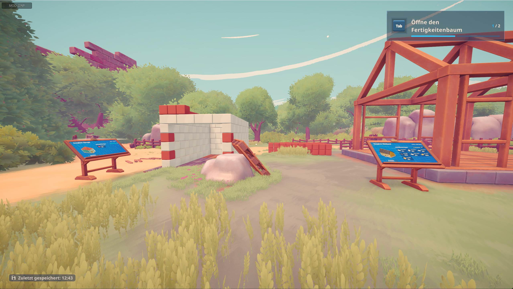
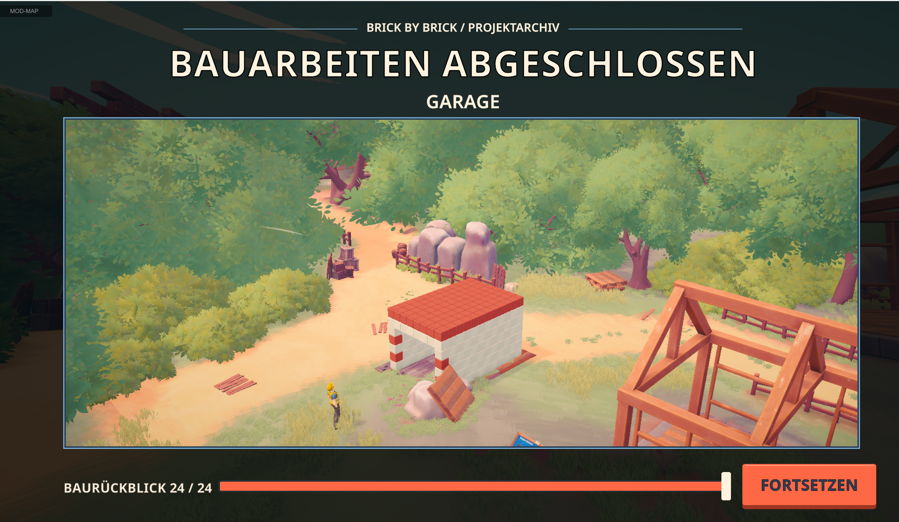
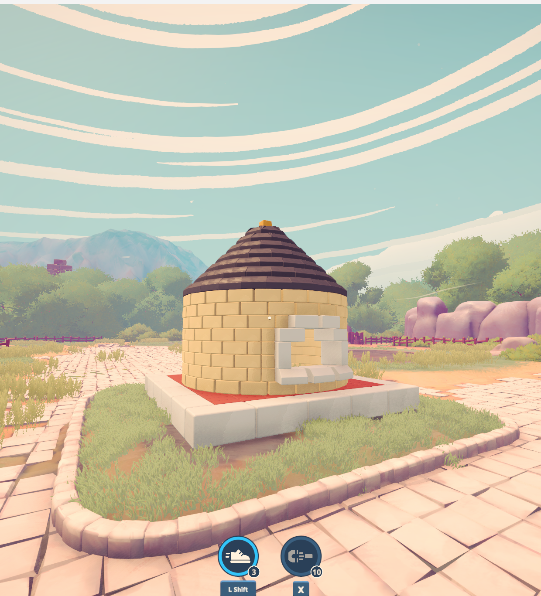
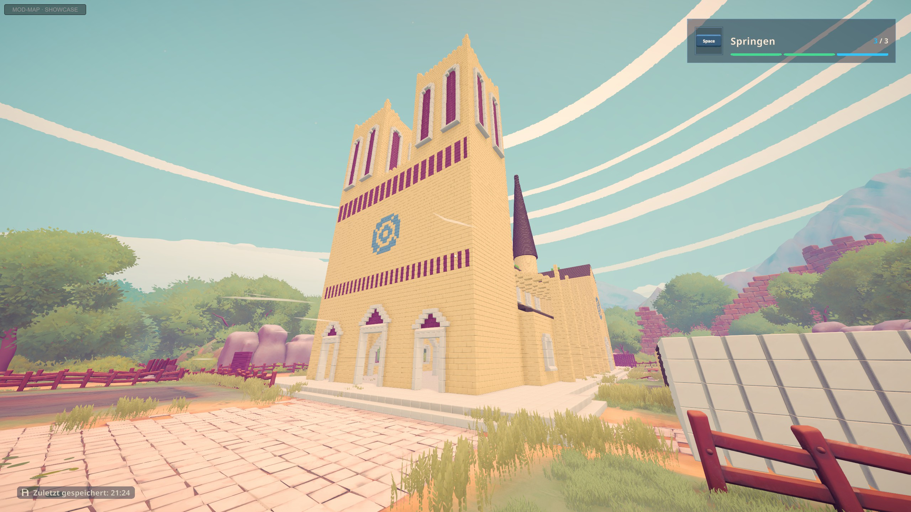
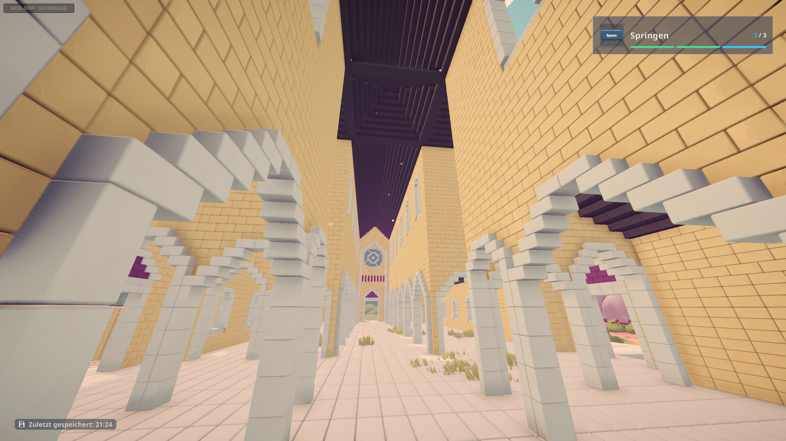

# Brick by Brick – Extra Buildings (Mod)

A mod for *Brick by Brick: Tidy Up the Small Town!* (Steam). It adds extra buildings to the game from a blueprint –
with real brick slots, holograms, construction sections, a blueprint board, a completion message and a build replay,
just like the original buildings. The main building is a simplified **Notre-Dame with 26,462 bricks**, with its own
walkable scaffold: [3D preview with brick list and construction sections](https://michel86ch-ui.github.io/brickbybrick-mod/notre-dame/).
Test buildings: a **garage with 191 bricks** and a **round tower with 311 bricks**.

> Unofficial fan mod, not made by the game's developers. This repository contains no game files.

## All mods and maps

Overview page: **[michel86ch-ui.github.io/brickbybrick-mod](https://michel86ch-ui.github.io/brickbybrick-mod/)**

| Map | More | Download |
|---|---|---|
| **Notre-Dame**: 26,462 bricks in five construction sites, with a walkable scaffold. **World slot 4** | [3D preview](https://michel86ch-ui.github.io/brickbybrick-mod/notre-dame/) · [screenshots](https://michel86ch-ui.github.io/brickbybrick-mod/showcase/) | [Extra Buildings 1.1.1](https://github.com/michel86ch-ui/brickbybrick-mod/releases/latest) |
| Test buildings: garage (191 bricks), round tower (311 bricks) | pictures below | in the same ZIP |
| **Taj Mahal** 1.0: about 40,000 bricks in seven construction sites, on a platform with four minarets. **World slot 3** | [3D preview](https://michel86ch-ui.github.io/brickbybrick-mod/taj-mahal/) · [screenshot](https://michel86ch-ui.github.io/brickbybrick-mod/showcase/taj-mahal-1.jpg) | [Extra Buildings 1.1.1](https://github.com/michel86ch-ui/brickbybrick-mod/releases/latest) |

| Mod | What it does | Download |
|---|---|---|
| **[Extra Buildings](https://github.com/michel86ch-ui/brickbybrick-mod)** (this repository) | the maps above, each in a world of its own | [BrickByBrick-ExtraBuildings-1.1.1.zip](https://github.com/michel86ch-ui/brickbybrick-mod/releases/latest) (Notre-Dame + Taj Mahal) |
| **[SkillPoints](https://github.com/michel86ch-ui/brickbybrick-mod-skillpoints)** | F10 in a world you host: +10 skill points | [skillpoints-mod.zip](https://github.com/michel86ch-ui/brickbybrick-mod-skillpoints/raw/main/skillpoints-mod.zip) |
| **[SkillModify](https://github.com/michel86ch-ui/brickbybrick-mod-skillmodify)** | the last skill levels carry 50 bricks and pull 50 with the magnet | [skillmodify-mod.zip](https://github.com/michel86ch-ui/brickbybrick-mod-skillmodify/raw/main/skillmodify-mod.zip) |
| **[Ladder](https://github.com/michel86ch-ui/brickbybrick-mod-ladder)** | an extension ladder to set up against a wall, climb and step off at the top | [ladder-mod.zip](https://github.com/michel86ch-ui/brickbybrick-mod-ladder/raw/main/ladder-mod.zip) |
| **[BuildHelper](https://github.com/michel86ch-ui/brickbybrick-mod-buildhelper)** | F8 shows the missing bricks through walls; F5 ghost hand places a brick you cannot reach, once every 10 minutes | [buildhelper-mod.zip](https://github.com/michel86ch-ui/brickbybrick-mod-buildhelper/raw/main/buildhelper-mod.zip) |

**Slots: the Taj Mahal is played in world slot 3, the Notre-Dame in world slot 4.** Each building lives in its own slot;
start it with its button in the main menu and create a new save in that slot.

Every ZIP contains the same unmodified BepInEx 5.4.23.5, so the mods work together: unzip one after the other into the
game folder and overwrite.







*Proof of concept for the [Notre-Dame](https://michel86ch-ui.github.io/brickbybrick-mod/notre-dame/)'s round parts: the 311-brick round test tower, built to completion in the game.*

## Notre-Dame in the game

The simplified Notre-Dame with about 26,500 bricks, shown finished in the game with the mod's showcase mode (0.5.0): west
front with bell towers, round choir, spire over the crossing, and inside arcades of pointed arches that carry the upper
walls. **[More screenshots](https://michel86ch-ui.github.io/brickbybrick-mod/showcase/)**

[](https://michel86ch-ui.github.io/brickbybrick-mod/showcase/)

[](https://michel86ch-ui.github.io/brickbybrick-mod/showcase/)

## Status (2026-10-25, version 1.1.1)

| Feature | Status |
|---|---|
| Brick slots, holograms, snapping into place | confirmed in game |
| Progress per section, blueprint board counts along | confirmed in game |
| Finished sections (final meshes), "Construction complete" message, build replay | confirmed in game |
| Plinth made of game bricks, own 3D model on the blueprint board (0.2.0) | confirmed in game |
| Mod map without the seven original buildings and their 18,485 bricks, garage in the town center (0.3.0) | confirmed in game |
| "Start Mod Map" / "Back to normal worlds" menu button with automatic restart (0.3.0) | confirmed in game |
| Saving and reloading the mod world | confirmed in game (an older test world reopened with its finished garage) |
| Round parts: 2x1 blocks along a circle (slightly overlapping), tilted pieces, a cone of roof-tile rings without flickering (0.3.1, round test tower with 311 bricks) | confirmed in game |
| Notre-Dame with about 26,500 bricks, [3D preview](https://michel86ch-ui.github.io/brickbybrick-mod/notre-dame/): loads as five construction sites (0.4.0), shown finished in showcase mode (0.5.0) | confirmed in game, [screenshots](https://michel86ch-ui.github.io/brickbybrick-mod/showcase/) |
| Notre-Dame: building it brick by brick: bricks snap in, sections finish, skill points are earned (0.5.0) | confirmed in game |
| Notre-Dame: start skill points for a new mod world (0.6.0) | confirmed in game |
| Notre-Dame: aluminium scaffold with landings at every stair corner, clerestory lanes, mobile scaffold unlocked and driving up ramps onto the plinth (1.0.0) | confirmed in game |
| Notre-Dame: a complete build | confirmed in game (26,462 of 26,462 bricks, all five sites) |
| Taj Mahal with about 40,000 bricks in seven construction sites, [3D preview](https://michel86ch-ui.github.io/brickbybrick-mod/taj-mahal/): shown finished in showcase mode, scaffold that goes once the building is complete (1.1.0) | showcase and building brick by brick confirmed in game, [screenshot](https://michel86ch-ui.github.io/brickbybrick-mod/showcase/taj-mahal-1.jpg) |
| Taj Mahal: ramp at 20°, its lower end 0.6 m in the ground, so the mobile scaffold drives onto it without a step (1.1.1) | not yet tested in game |

## Mod map: a separate world instead of the main world

An extra building changes the building list of a save; the game then no longer counts that world's run for the
leaderboard. That is why the mod only builds in a world of its own, the **mod map** (default: world slot 4).

The game loads the town scene once per game start and opens the worlds inside it. The mode therefore applies to the
whole game session:

| Mode | Behavior |
|---|---|
| normal (default) | The mod does nothing. The mod world is locked, because without the mod the game would drop the extra buildings' bricks when loading it. |
| mod map | The seven original buildings and their bricks are removed, the extra buildings are injected, every world choice in the menu opens the mod world, "MOD-MAP" is shown top left. |

The main menu has a button top left: **Start Mod Map** in a normal session, **Back to normal worlds** in a mod-map
session. It saves the mode and restarts the game through Steam.

Placed bricks are saved with their world position. Do not move a site (`F9` or `X`/`Z` in the config) in a mod world
that already has bricks on it: they would stay behind at the old place. Delete the mod world first.

## Installation

1. Download **[BrickByBrick-ExtraBuildings-1.1.1.zip](https://github.com/michel86ch-ui/brickbybrick-mod/releases/latest)**
   and unzip everything into the game folder, so that `winhttp.dll` sits next to `BrickByBrick.exe`
   (Steam: right-click the game > Manage > Browse local files).
2. Start the game. Top left in the main menu: **Start Taj Mahal (world 3)** or **Start Notre-Dame (world 4)**. The
   game restarts.
3. **Important: the Taj Mahal is played in slot 3, the Notre-Dame in slot 4.** Create a new save in that slot; it must
   be empty (the mod never opens a slot that holds a normal save as a mod world).

Back to your own worlds: **Back to normal worlds** in the main menu. A new mod world starts with 20 skill points
(`StartSkillPoints` in `BepInEx\config\michel.brickbybrick.extrabuildings.cfg`, 0 = like the base game), and the
mobile scaffold is unlocked (`UnlockScaffoldLift`): in the base game it comes with the town's house, which the mod
map does not have. The ZIP contains BepInEx 5.4.23.5 (unmodified), the mod with its blueprints and a ready config.

Updating from 1.0.0, 1.1.0 or the Taj Mahal beta: your worlds continue (1.0.0 only gains a stair tower inside the
Notre-Dame's scaffold; 1.1.1 only makes the Taj Mahal's ramp steeper). A Notre-Dame world built with 0.6.0 or earlier does not fit the blueprint:
start a new save in slot 4.

Uninstall: delete `winhttp.dll`, `doorstop_config.ini`, `.doorstop_version`, `changelog.txt`,
`ExtraBuildings-README.txt` and the `BepInEx` folder in the game folder. The game itself is not modified.

## Building

```
cd mods\ExtraBuildings
dotnet build -c Release -p:DeployToGame=true     (copies the DLL + blueprints\*.json into the game)
py tools\gen_garage.py                            (regenerate the garage blueprint)
py tools\gen_roundtest.py                         (regenerate the round test tower)
py tools\gen_notredame.py 1.2                     (Notre-Dame design, scale 1.2)
py tools\build_preview.py                         (3D preview page -> docs\notre-dame\index.html)
```

The project references the DLLs directly from the game folder (adjust `GameDir` in the `.csproj` if the game is
installed elsewhere).

| Folder | Content |
|---|---|
| [mods/ExtraBuildings](mods/ExtraBuildings/) | The mod (C#, BepInEx 5 / HarmonyX) |
| [tools](tools/) | Blueprint generators (Python) |
| [blueprints](blueprints/) | Generated blueprints (JSON) |
| [docs](docs/) | Screenshots and the [Notre-Dame 3D preview](https://michel86ch-ui.github.io/brickbybrick-mod/notre-dame/) (GitHub Pages) |

## How the game builds its buildings

Measured in the game code (Unity 6000.3.6, Mono) and in the scene data:

- Buildings are **not in the code** but in the scene: 7 `ConstructionSite`s with 18,485 brick slots in total.
- Loose bricks: one `BrickWorldCatalog` with exactly 18,485 bricks, GPU-instanced through `BrickWorldSource`.
- Scene start (`GameSceneInstaller.OnSceneEnterAsync`): register the slots -> register the brick catalog ->
  apply the save. After that, one `ConstructionSceneInstaller` per building initializes its site.
- A brick slot is a GameObject with `PlacementSlot` + `ConstructionSlot` and a `Hologram` child. Slot ID and brick ID
  are `uint`. A brick's pivot is its center, the grid is 0.21 m.
- `PlacementSlot.placeTrigger` is the building's site area: a brick can only be placed while standing inside it.
- Every site has a baked topology (`bakedSpecs`) that `GetBakedSpecs()` checks strictly against the slots.
- Once a section is complete, the game shows a combined mesh (`finalVisualRoot`) instead of the single bricks.
- The blueprint board shows a single pre-made mesh (`ConstructionBlueprintPreview.modelPrefab`).
- Missing bricks or slots do not break loading: bricks from removed slots return to their start position,
  unknown bricks are dropped.
- Saves are JSON (EasySave3), their sections Base64-encoded JSON.
